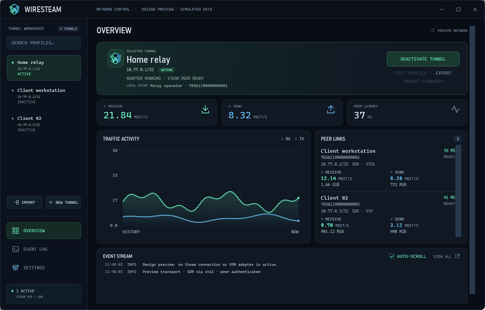

# WireSteam

A Windows VPN that carries WireGuard traffic over Steam P2P / Steam Datagram Relay. Connect to peers by SteamID64 instead of a public IP address.

- Private networks with multiple peers.
- IPv4 Internet access through a gateway computer.
- TCP and UDP forwarding for local services.
- Desktop controls, system tray, live peer statistics and searchable logs.



*Preview with simulated traffic and peers.*

## Requirements

- Windows 10 22H2 (build 19045) or Windows 11, x64.
- [Official WireGuard for Windows](https://www.wireguard.com/install/) installed in its standard location.
- Steam running and signed in; a different Steam account on each computer.
- Administrator approval when creating or removing an adapter.

Run WireSteam as your normal Windows user, at the same access level as Steam. The desktop app includes its .NET runtime.

The default Steam AppID is **480**, intended for development. Production deployment requires your own Steamworks AppID and appropriate Valve access. Connectivity depends on Steam and relay availability.

## Install

Run `WireSteam-<version>-x64.msi` and open **WireSteam** from the Start menu. Setup requires WireGuard and replaces other installed WireSteam versions. See [installation and updates](INSTALLER.md).

For portable use, extract `WireSteam-win64.zip` and run `WireSteam.UI.exe`. Keep the engine, helper and Steam DLL together.

## Connect two computers

1. Generate a profile on each computer using the commands below.
2. Exchange **public keys** and **SteamID64** values. Keep private keys secret.
3. Add the other computer as a `[Peer]` in each profile.
4. Import the profiles into the desktop app and select **Activate tunnel**.

```powershell
# Computer A
.\WireSteam.exe init a.conf --address 10.77.0.1/32

# Computer B
.\WireSteam.exe init b.conf --address 10.77.0.2/32
```

Add this to `a.conf`, replacing the placeholders:

```ini
[Peer]
PublicKey = <PUBLIC_KEY_FROM_B>
SteamID = <STEAM_ID64_OF_B>
AllowedIPs = 10.77.0.2/32
PersistentKeepalive = 25
```

In `b.conf`, use A's public key, SteamID and `AllowedIPs = 10.77.0.1/32`. The [example profiles](examples/) show the complete format.

For command-line use:

```powershell
.\WireSteam.exe check a.conf
.\WireSteam.exe up a.conf --name home
```

Use `b.conf` on B. Press **Ctrl+C** to stop. If cleanup was interrupted, run `.\WireSteam.exe down --name home`.

Closing the desktop window keeps tunnels running in the tray. Use **Quit WireSteam** to disconnect and exit.

## Guides

- [Desktop app and tray](GUI.md)
- [Configuration and CLI reference](CONFIGURATION.md)
- [Internet gateway setup](INTERNET.md)
- [TCP and UDP port forwarding](FORWARDING.md)
- [Standalone bandwidth tools](SPEEDTEST.md)
- [Installation and updates](INSTALLER.md)

Private-network mode does not route Internet traffic. Internet mode is IPv4 only and has additional uplink and VPN-coexistence restrictions; read its guide before enabling it. Local automated checks do not replace testing between your computers.

For source builds and changes, see CONTRIBUTING.md in the source repository. WireSteam uses the [MIT license](LICENSE); dependencies have [separate terms](THIRD_PARTY_NOTICES.md).
